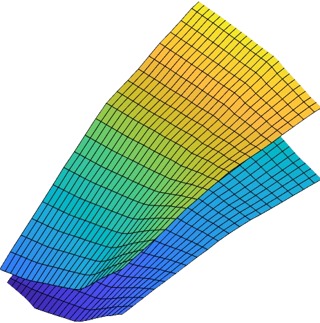

# LongPDFs

Hi! This is a repo with a few of my longer writeups in various fields. Some of them used to live on my website, but I decided that devoting a block of my website to a long PDF is somewhat lame.

- [Hari_Research_Ultrasound.pdf](Hari_Research_Ultrasound.pdf): Ultrasound imaging research
- [JS_Probability_Playing_Cards_10_17.pdf](JS_Probability_Playing_Cards_10_17.pdf): The only solutions online, I think.
- [warps_and_squares.pdf](warps_and_squares.pdf): A very cool problem proposed to me in late 2025/early 2026, that earlier models of GPT notably couldn't solve.
